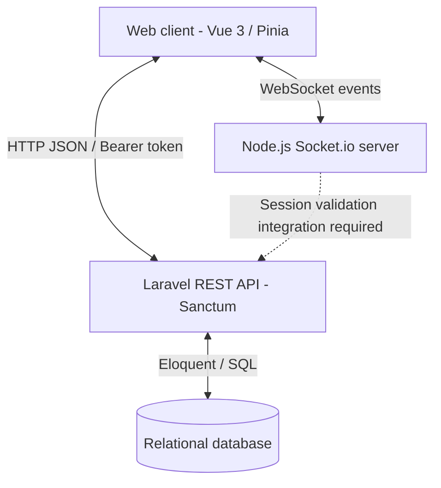

# Real-Time Multiplayer Web Platform

[](https://laravel.com/)
[](https://vuejs.org/)
[](https://nodejs.org/)
[](https://socket.io/)
[](https://www.mysql.com/)
[](https://www.docker.com/)

## Overview

The platform separates transactional operations from gameplay transport: a Laravel REST API handles authentication, persistent user and match data, shop operations, and relational migrations, while a Node.js Socket.io service manages lobby/game state in process memory and relays gameplay events. Vue 3 consumes both interfaces: HTTP for persisted data and Socket.io for interactive game sessions. This split avoids putting a high-frequency game loop on the conventional PHP request lifecycle, but the current socket implementation relays client-supplied moves and end-game results rather than independently validating them; it must not be treated as an authoritative competitive-game engine without additional server-side validation.

## Repository layout and implementation status

| Path | Responsibility |
| --- | --- |
| `api/` | Laravel 12 API, Sanctum dependency, route definitions, database migrations, and PHPUnit/Pest test configuration. |
| `frontend/` | Vue 3/Vite client with Pinia and Socket.io client dependencies. |
| `websockets/` | Node.js Socket.io server, in-memory users/games, and event handlers. |
| `deployment/` | Dockerfiles and Kubernetes manifests for the frontend, API, and WebSocket service. |

**Configuration note:** the repository currently has no root `docker-compose.yml`. The supplied Laravel `.env.example` defaults to SQLite, not MySQL. Dockerfiles and Kubernetes manifests exist, but a MySQL-backed Compose quickstart is not currently configured. The badges describe the intended/declared stack, not a checked-in Compose topology.

## Distributed system architecture



The dashed service-to-service link is an integration boundary, not a verified current implementation: the checked-in Socket.io `join` handler accepts a user object from the client and associates it with the socket. It does not validate a Sanctum bearer token with Laravel. Do not rely on that client-supplied identity for authorization or account-sensitive actions.

### Request and state ownership

| Concern | Current owner | Persistence / consistency |
| --- | --- | --- |
| Login, profile, shop, coins, match history | Laravel API | Relational API operations; protected API routes use `auth:sanctum`. |
| Lobby, connected users, active game status | Node.js Socket.io process | In-memory `Map`; state is lost on process restart and is not shared across replicas. |
| Live move and state exchange | Browser and Node.js relay | The current event handler forwards client data; it does not validate turns or calculate game results authoritatively. |
| Final match result and rewards | Laravel should be the persistence authority | Persist using authenticated, validated API operations and database transactions. A trusted server-side result-validation flow is required before awarding coins/rank changes. |

### Engineering trade-offs and constraints

- **HTTP versus WebSockets:** REST is appropriate for request/response operations and database transactions. WebSockets avoid repeated polling requests for lobby/game updates and provide a bidirectional event channel. A separate Node.js process keeps socket connections and in-memory game state out of the PHP request lifecycle. A PHP WebSocket runtime could also support long-lived connections, but is not the architecture used here.
- **Memory versus durable state:** the current Node service stores game/lobby data in process memory. This provides simple low-overhead access for a single process, but process restart loses active sessions and multiple replicas do not share state. Production horizontal scaling requires shared state/pub-sub (for example, a Socket.io adapter backed by Redis) and a recovery policy.
- **Result consistency:** treat the socket state as transient gameplay state, not the financial or ranking ledger. The API should validate a completed match, then update match history, balances, and ranking in a single database transaction. Use an idempotency key or unique match identifier to prevent duplicate result submissions and reward grants. The present socket handler accepts a client-declared winner, so this integrity boundary is not yet enforced.
- **Authentication and access control:** Laravel API routes under `auth:sanctum` require authenticated requests; `/admin/history` additionally applies the `admin` middleware. Keep purchases, balance changes, account operations, and history access behind server-side authorization. Socket authentication must independently verify a short-lived credential with the API (or a trusted shared verifier) before binding a user identity to a connection; never trust a user ID or role sent as ordinary socket payload data.

## Local development

### Prerequisites

- PHP 8.2+, Composer, and a database configured for the API.
- Node.js compatible with the frontend engine requirement (`^20.19.0 || >=22.12.0`), and Bun for the checked-in frontend/WebSocket Docker build files (or npm for local package installation).
- Docker is required for the supplied container images. A `docker-compose.yml` is **not** included at this time.

### API

```bash
cd api
cp .env.example .env
composer install
php artisan key:generate
php artisan migrate --seed
php artisan serve --host=0.0.0.0 --port=8000
```

The checked-in `.env.example` configures SQLite. Configure `DB_CONNECTION=mysql` and the matching `DB_HOST`, `DB_PORT`, `DB_DATABASE`, `DB_USERNAME`, and `DB_PASSWORD` values if using MySQL; ensure the database is available before running migrations. Do not commit environment secrets.

### Frontend

```bash
cd frontend
npm install
npm run dev
```

Vite prints its actual local URL on startup (typically `http://localhost:5173`). Configure the API and socket URLs using the environment variables expected by the frontend before testing against non-default hosts.

### WebSocket service

```bash
cd websockets
npm install
node index.js
```

`websockets/index.js` defaults to port `3000` and reads `PORT`. The service Dockerfile currently declares `8080` and sets `APP_PORT=8080`, while the entry point does not read `APP_PORT`; align those settings before relying on that image's port configuration.

### Local endpoints and deployment ports

| Service | Local development | Checked-in deployment configuration |
| --- | --- | --- |
| Frontend | Vite default `http://localhost:5173` | Kubernetes ingress routes to the frontend service on port `80`. |
| Laravel API | `http://localhost:8000` with `artisan serve` | Kubernetes ingress routes to the API service on port `80`. |
| Socket.io | `http://localhost:3000` by default | Ingress targets the WebSocket service on port `3000`; the Dockerfile currently declares `8080` (see note above). |
| Database | SQLite from the example environment; MySQL can be configured | No MySQL container or Compose service is checked in. |

The requested `docker compose up --build` and `docker compose exec backend ...` workflow cannot run from this repository as-is because there is no Compose manifest or service named `backend`. Add and verify a Compose file, service names, environment settings, and health checks before documenting those commands as executable.

## HTTP API routes

Routes below are registered in `api/routes/api.php`; `{base}/api` denotes the Laravel API prefix. `Bearer` indicates a Sanctum-protected route.

| Method | Path | Access | Purpose |
| --- | --- | --- | --- |
| `POST` | `/login` | Public | Authenticate. |
| `GET` | `/status` | Public | API/database status check. |
| `GET` | `/shop` | Public | List shop items. |
| `GET` | `/scoreboard/global` | Public | Global scoreboard. |
| `GET` | `/image-proxy/{filename}` | Public | Proxy an item image. |
| `GET` | `/card-image-proxy/{filename}` | Public | Proxy a card image. |
| `GET`, `PUT` | `/users/me` | Bearer | Read or update the authenticated profile. |
| `POST` | `/logout` | Bearer | Revoke/logout the current session. |
| `GET` | `/me/statistics` | Bearer | Read personal statistics. |
| `POST`, `GET` | `/matches`, `/history/matches` | Bearer | Record a match or list match history. |
| `GET` | `/scoreboard/personal` | Bearer | Personal scoreboard. |
| `GET` | `/me/coins`, `/me/coin-transactions` | Bearer | Read balance and transaction history. |
| `GET` | `/me/achievements` | Bearer | Read achievements. |
| `POST` | `/me/account/delete` | Bearer | Delete the authenticated account. |
| `POST` | `/shop/buy`, `/shop/equip` | Bearer | Purchase or equip a shop item. |
| `GET` | `/admin/history` | Bearer + admin middleware | Read administrative match history. |

Example authenticated request:

```bash
curl --fail-with-body \
  -H "Accept: application/json" \
  -H "Authorization: Bearer ${SANCTUM_TOKEN}" \
  http://localhost:8000/api/users/me
```

## Socket.io protocol

The current event handlers use these event names. They differ from generic names such as `join_room`, `player_moved`, `game_over`, and `match_forfeit`; those are not the implemented protocol in the checked-in handlers.

| Direction | Event | Payload / effect |
| --- | --- | --- |
| Client → server | `join` | User object; currently associated with the socket without API token verification. |
| Client → server | `create-game` | `playMode`, `biscaType`; creates a pending in-memory game. |
| Client → server | `join-game` | `{ "gameId": 12 }`; joins an available game. |
| Client → server | `get-games` | Requests lobby list. |
| Client → server | `game:sync_initial_state` | Initial state; server broadcasts `game:started` to the game room. |
| Client → server | `game:move` | `{ "gameId": 12, "card": { ... } }`; server relays `game:opponent_move` to the other player. |
| Client → server | `game:sync_state` | `{ "gameId": 12, "gameState": { ... } }`; server relays `game:state_update`. |
| Client → server | `game:declare_end` | `{ "gameId": 12, "winner": ... }`; current server trusts the supplied winner and emits `game:ended`. |
| Client → server | `game:cancel` | `{ "gameId": 12 }`; creator may cancel a pending game. |
| Server → client | `games` | Current lobby list. |
| Server → client | `game:initialize`, `game:started` | Game initialization and initial state. |
| Server → client | `game:opponent_move`, `game:state_update` | Relayed opponent move or state. |
| Server → client | `game:ended`, `game:error` | End state or socket-side error. |

Example move event using the implemented event name:

```js
socket.emit("game:move", {
  gameId: 12,
  card: { code: "A-hearts", suit: "hearts", rank: "A" }
});

socket.on("game:opponent_move", ({ card }) => {
  // Apply the relayed move to the client view.
});
```

Do not use the payload above as proof of a valid move. The server currently forwards it without checking game membership, turn order, card ownership, or game rules. Validate those conditions server-side before using game outcomes to update durable records or grant rewards.

## Tests and quality checks

### Laravel

The backend defines a Composer test script and PHPUnit suites in `api/tests/Unit` and `api/tests/Feature`:

```bash
cd api
composer test
# Equivalent:
php artisan test
```

### Frontend

The frontend package currently defines `dev`, `build`, and `preview` scripts, but no unit/functional test script:

```bash
cd frontend
npm run build
```

### WebSocket service

No test script is defined in `websockets/package.json`. Run the service locally and exercise the protocol with a Socket.io client; add automated tests for authorization, turn validation, reconnect behavior, and duplicate/out-of-order events before depending on those guarantees.

## Deployment

`deployment/` contains Dockerfiles for Laravel, Vue, and WebSockets and Kubernetes manifests including an ingress. Build images using the Dockerfiles in `deployment/` (the repository `justfile` provides `laravel-build`, `vue-build`, and `ws-build` recipes) and configure Kubernetes services/ingress ports consistently with the application entry points. No Docker Compose or MySQL deployment manifest is currently present.
